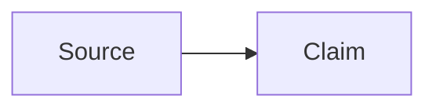

# Obsidian Flavored Markdown

Use isto como um fallback compacto para a sintaxe específica do Obsidian.
Prefira a skill `obsidian-markdown` de `kepano/obsidian-skills` instalada
separadamente, quando disponível, e depois o [Obsidian Help](https://help.obsidian.md/) atual, para perguntas detalhadas ou sensíveis a versão.

Resolva a raiz do produto instalado a partir da localização desta skill, e não
do vault ou do diretório de trabalho atual:

```bash
PRODUCT_ROOT=/absolute/path/to/installed/claude-obsidian
CORE="$PRODUCT_ROOT/scripts/claude-obsidian.py"
test -f "$CORE"
```

Todo link `../wiki/references/` neste arquivo resolve da mesma forma, relativo
ao diretório desta skill sob `$PRODUCT_ROOT`, nunca relativo ao diretório
`wiki/` do vault selecionado.

Responda a perguntas de sintaxe em modo somente leitura. Se o usuário pedir uma
edição no vault, redija a nota completa, leia
[operation-transactions.md](../wiki/references/operation-transactions.md) e
construa um único bundle `claude-obsidian.transaction.v1` com
`operation_type: markdown` e apenas alvos em `wiki/`. Inspecione-o, então
defina `APPROVAL_SHA256` para o `approval_sha256` retornado após a revisão e
aplique-o através do mesmo plano vinculado ao vault. Uma criação ou remoção de
página canônica inclui, nesse bundle, a atualização de um índice ativo ou de um
MOC; atualize o overview apenas quando sua síntese estável de alto nível mudou:

```bash
python3 "$CORE" transaction inspect "$BUNDLE" --vault "$VAULT"
python3 "$CORE" transaction apply "$BUNDLE" --vault "$VAULT" \
  --approved-plan-sha256 "$APPROVAL_SHA256"
```

Nunca escreva uma nota diretamente.

## Properties

Use properties YAML planas e datas em `YYYY-MM-DD`. Coloque aspas em wikilinks
dentro do YAML.

```yaml
---
type: concept
title: "Contextual Retrieval"
created: 2026-07-11
updated: 2026-07-11
status: developing
tags:
  - retrieval
  - ai/knowledge
aliases:
  - Context-aware retrieval
related:
  - "[[Retrieval]]"
sources:
  - "[[Anthropic Contextual Retrieval]]"
---
```

Não aninhe objetos nas properties do wiki geradas. Use listas de blocos em vez de
arrays YAML inline. Coloque aspas em valores de tag que são apenas numéricos, por
exemplo `- "2026"`, para que os parsers de YAML os preservem como tags em vez de
números. Mantenha properties existentes desconhecidas, a menos que a edição
solicitada as altere.

## Wikilinks e embeds

```markdown
[[Note Name]]
[[Note Name|Display text]]
[[Note Name#Heading]]
[[Note Name#^block-id]]
[[Folder/Note Name]]

This paragraph is addressable. ^evidence-block

![[Note Name#Summary]]
![[diagram.png|480]]
![[paper.pdf#page=3]]
```

Case o nome do arquivo alvo exatamente. Use um path de pasta relativo ao vault
quando um basename for ambíguo. Use links Markdown padrão para URLs externas;
use wikilinks para as notas deste vault.

## Callouts

```markdown
> [!note]
> Supporting context.

> [!warning] Review required
> This claim has contradictory evidence.

> [!question]- Open question
> What evidence would resolve this?
```

`-` inicia recolhido e `+` inicia expandido. Tipos embutidos comuns incluem
`note`, `abstract`, `info`, `todo`, `tip`, `success`, `question`, `warning`,
`failure`, `danger`, `bug`, `example` e `quote`. Preserve os tipos de callout
customizados do vault em vez de reescrevê-los.

## Outra sintaxe do Obsidian

````markdown
#inline-tag #nested/tag

==Highlighted text==

Visible text %%hidden comment%%

Inline math: $E = mc^2$

$$
\int_0^1 x^2\,dx = \frac{1}{3}
$$


````

Headings, listas, tarefas, tabelas, code fences e footnotes padrão do
CommonMark/GFM continuam válidos. Evite HTML quando o Markdown nativo for
suficiente.

## Validar uma nota redigida

- Faça o parse da fronteira do YAML e mantenha os tipos das properties
  consistentes.
- Verifique todo alvo interno, heading e referência de bloco que possa ser
  conferido localmente; nunca fabrique um alvo para fazer um link parecer
  completo.
- Mantenha a redação da evidência distinta da inferência e preserve os
  localizadores de fonte.
- Assegure que code fences e a citação de callouts estejam balanceados.
- Rode o lint determinístico do wiki após uma mutação solicitada e reporte os
  achados restantes sem repará-los silenciosamente.

Para páginas com fontes citadas, siga também
[provenance.md](../wiki/references/provenance.md). Reporte o operation ID da
transação e os paths exatos alterados depois de uma edição aplicada.
